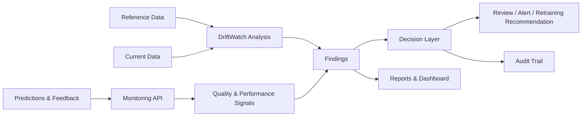

<div align="center">

# DriftWatch

### Intelligent drift monitoring for machine learning systems.

**Detect shifts. Understand risk. Make better decisions.**

DriftWatch is a self-hostable ML monitoring platform for examining changes in data, tracking model quality, and turning monitoring findings into actionable review and retraining workflows.

<p>
  <a href="https://github.com/Tripathi-Nishant/DRIFT-WATCH"></a>
  <a href="LICENSE"></a>
  
  
  
</p>

[Request Beta Access](https://diftwatch-request-landing-page.vercel.app/) · [Report an Issue](https://github.com/Tripathi-Nishant/DRIFT-WATCH/issues) · [Explore the Code](https://github.com/Tripathi-Nishant/DRIFT-WATCH)

</div>

---

## The idea

Machine-learning systems operate in changing environments. Incoming data can shift, feature quality can deteriorate, and model performance can become harder to assess as real-world conditions evolve.

DriftWatch brings key monitoring workflows into one self-hostable product. It helps teams inspect reference-versus-current data, review drift and data-quality findings, ingest predictions and delayed feedback, and manage recommendations such as review, alerting, or retraining.

**The goal is not to flag every change. It is to help teams understand what changed and decide what deserves attention.**

## What you can do

<table>
<tr>
<td width="50%" valign="top">

### 01 · Detect changes

Analyze tabular reference and current datasets using statistical drift and data-quality checks. Inspect feature-level findings and monitoring reports.

</td>
<td width="50%" valign="top">

### 02 · Track model signals

Ingest predictions and feedback to support monitoring workflows when ground-truth labels arrive later than predictions.

</td>
</tr>
<tr>
<td width="50%" valign="top">

### 03 · Turn findings into decisions

Use the decision layer to surface review, alert, and retraining recommendations instead of treating every detected shift as the same operational event.

</td>
<td width="50%" valign="top">

### 04 · Keep workflows auditable

Use authenticated access, roles, projects, API keys, audit events, and retraining request history to organize monitoring operations.

</td>
</tr>
<tr>
<td width="50%" valign="top">

### 05 · Run it yourself

Deploy the application with Docker Compose, use PostgreSQL-backed persistence, and keep the monitoring stack under your own operational control.

</td>
<td width="50%" valign="top">

### 06 · Inspect reports

Review monitoring results through the web dashboard or generate a self-contained HTML report from the Python library.

</td>
</tr>
</table>

## How it fits together



*Conceptual workflow. Exact capabilities depend on the enabled integration and configuration.*

## Get started

### Option A — Run the full stack with Docker

**Requirements:** Docker Desktop with Docker Compose v2.

From the repository root, run in PowerShell:

```powershell
Copy-Item .env.example .env
```

Open `.env` and replace the placeholder secrets with strong, unique values. Then start the application:

```powershell
docker compose up -d --build
```

Check service status and health:

```powershell
docker compose ps
curl http://localhost:8765/healthz
curl http://localhost:8765/readyz
```

Open **http://localhost:8765** in your browser.

To inspect logs:

```powershell
docker compose logs -f
```

To stop the stack:

```powershell
docker compose down
```

> Before using real or sensitive data, review the environment configuration, authentication settings, database persistence, backup process, and network exposure.

### Option B — Install for local Python development

**Requirements:** Python 3.11 or newer. Python 3.12 is recommended.

Create and activate a virtual environment:

```powershell
python -m venv .venv
.\.venv\Scripts\Activate.ps1
python -m pip install --upgrade pip
python -m pip install -e ".[dev,server]"
```

Run the test suite:

```powershell
pytest
```

Start the development server:

```powershell
driftwatch serve
```

If PowerShell blocks virtual-environment activation, use the Python executable directly:

```powershell
.\.venv\Scripts\python.exe -m pip install -e ".[dev,server]"
.\.venv\Scripts\python.exe -m pytest
```

### Option C — Analyze two datasets with the Python library

Until a package release is published to PyPI, install the repository version:

```bash
python -m pip install "driftwatch @ git+https://github.com/Tripathi-Nishant/DRIFT-WATCH.git"
```

Compare a reference dataset with a current dataset:

```bash
driftwatch run \
  --reference reference.csv \
  --current current.csv \
  --out report.html
```

The command is intended to produce a self-contained HTML report containing configured drift scores, feature distributions, data-quality findings, monitoring tests, decision trace, and optional model-performance metrics.

### Use the library from Python

```python
from driftwatch import Monitor

monitor = Monitor.from_reference(
    reference_df,
    model_name="my-model",
)

report = monitor.run(current_df)
report.save_html("report.html")
```

`reference_df` and `current_df` represent your reference and current pandas DataFrames. Check the current API and examples in the repository if your installed revision uses different method signatures.

## Beyond tabular data

DriftWatch also includes local-first text and image analysis helpers for experimentation.

### Text

```python
from driftwatch import analyze_text

report = analyze_text(
    reference_questions,
    current_questions,
)
```

### Images

```python
from driftwatch import analyze_images, load_image_batch

reference_images = load_image_batch([
    "data/reference/a.png",
    "data/reference/b.png",
])

current_images = load_image_batch([
    "data/current/a.png",
    "data/current/b.png",
])

report = analyze_images(reference_images, current_images)
```

For optional image-related dependencies, install the relevant extra if supported by your checked-out revision:

```bash
python -m pip install "driftwatch[production]"
```

Image monitoring is described as a transparent baseline for signals such as image shape, brightness, contrast, clipping, edge energy, and pixel distributions. These checks do **not** by themselves establish semantic image drift or prove that model accuracy has degraded. Semantic embeddings are an optional future extension.

## Configuration and storage

The default local store is `.driftwatch/driftwatch.db`.

| Setting | Purpose |
|---|---|
| `DRIFTWATCH_DB` | Select an alternate SQLite database file |
| `DRIFTWATCH_DATABASE_URL` | Configure a PostgreSQL connection |
| `DRIFTWATCH_EMBEDDING_MODEL` | Enable the configured text-embedding option, where supported |
| `DRIFTWATCH_IMAGE_EMBEDDING_MODEL` | Enable the configured CLIP/image-embedding option, where supported |
| `DRIFTWATCH_SMTP_*` | Configure optional email alerts |

See `.env.example` and the deployment documentation for the complete configuration. Keep secrets out of source control and never expose server credentials in frontend environment variables.

Webhook notifications are described as supporting Slack/Discord-compatible endpoints with retries. Validate provider behavior, delivery guarantees, and credentials in your own environment before depending on alerts operationally.

## Technology

| Layer | Technologies |
|---|---|
| Analysis library | Python, pandas, NumPy, statistical monitoring utilities |
| API | FastAPI / Python server components |
| Dashboard | React, Vite |
| Persistence | SQLite for local use; PostgreSQL for configured deployments |
| Deployment | Docker Compose |
| Quality checks | pytest, CI workflows and browser tests where configured |

This table describes the intended repository stack. Check the project configuration and deployment docs for the exact components enabled in a particular release.

## Repository map

```text
src/driftwatch/       Core library, API, security, storage, metrics and workflows
dashboard/            React/Vite dashboard and browser tests
tests/                Unit and integration tests
migrations/           PostgreSQL schema migrations
docs/                 Deployment and capability documentation
bench/                Research and comparison experiments
tools/                Migration and load-test utilities
examples/              Example integrations and demos
```

The optional `examples/placement-predictor-demo/` integration is intended for testing DriftWatch. It is not required by the dashboard or core package.

## Documentation

- [Getting started and placement case study](START_HERE.md)
- [Production deployment](docs/production.md)
- [PostgreSQL setup](docs/postgresql.md)
- [Capabilities](docs/capabilities.md)
- [Contributing](CONTRIBUTING.md)
- [Security policy](SECURITY.md)

Some links may depend on the current repository layout. If a document is not present in your branch, update the link or add the document before publishing.

## Current status

**DriftWatch v0.1.0 — Early Beta**

The project is intended for early evaluation by ML engineers, students, researchers, and AI/ML teams. Core workflows are described as implemented, but feature coverage and deployment behavior can vary by configuration.

Before a high-stakes or production rollout, validate:

- Detection behavior on your data, including sample-size and missing-value edge cases.
- Whether detected drift corresponds to meaningful model-performance changes.
- Authentication, authorization, secrets management, and network exposure.
- Database migrations, backup and restore procedures, and capacity limits.
- Alert delivery and integrations with your chosen providers.

**Important:** Statistical drift is evidence that data distributions have changed; it is not, on its own, proof that model performance has degraded. Performance conclusions require suitable labels, outcome measurements, or other validation.

## Contributing

Contributions, bug reports, reproducible examples, and thoughtful feedback are welcome. Please open an issue to discuss substantial changes before submitting a pull request. See [CONTRIBUTING.md](CONTRIBUTING.md) for project-specific guidance.

## Security

Please do not report security vulnerabilities in public issues. Follow the instructions in [SECURITY.md](SECURITY.md), if available, or contact the maintainers privately.

## License

DriftWatch is released under the [MIT License](LICENSE).

---

<div align="center">

**DriftWatch** · Understand the shift. Decide what comes next.

Built for people who build and operate machine-learning systems.

[Request Beta Access](https://diftwatch-request-landing-page.vercel.app/)

</div>
